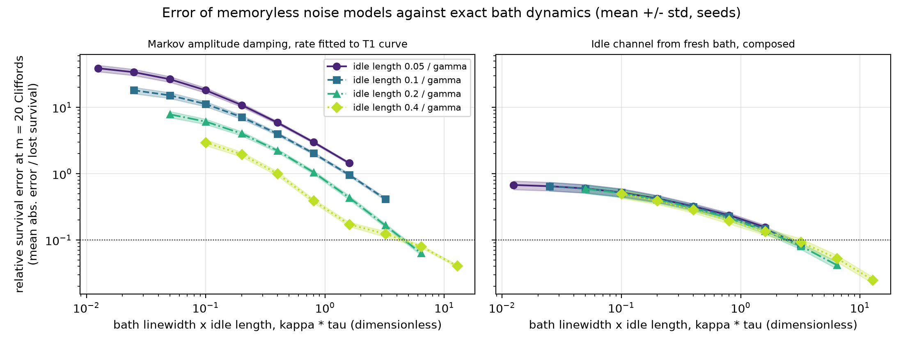
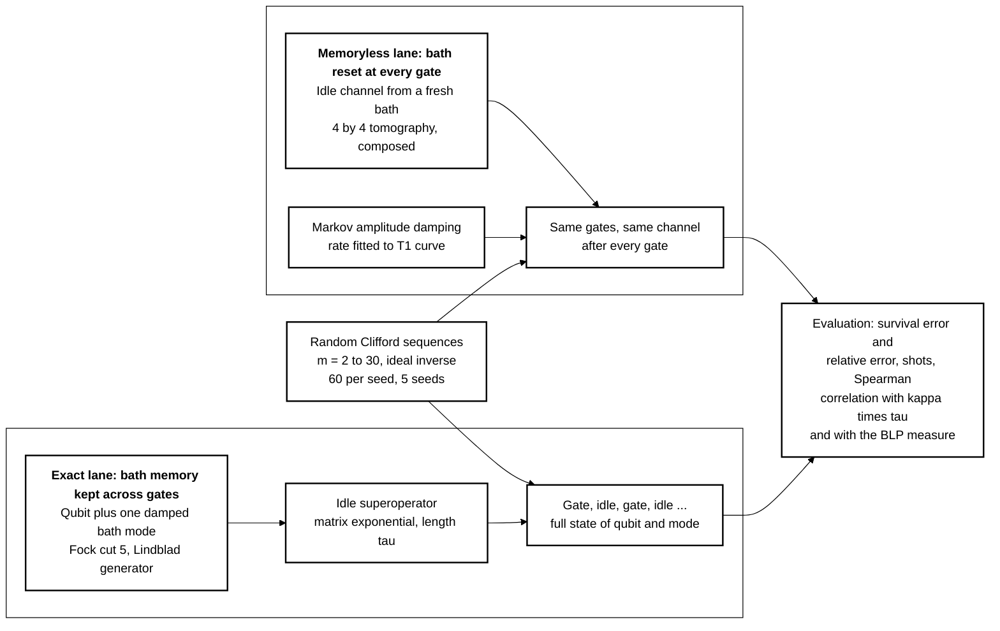
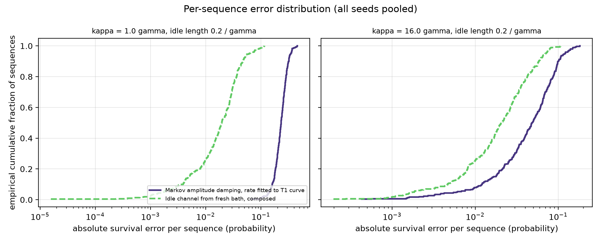
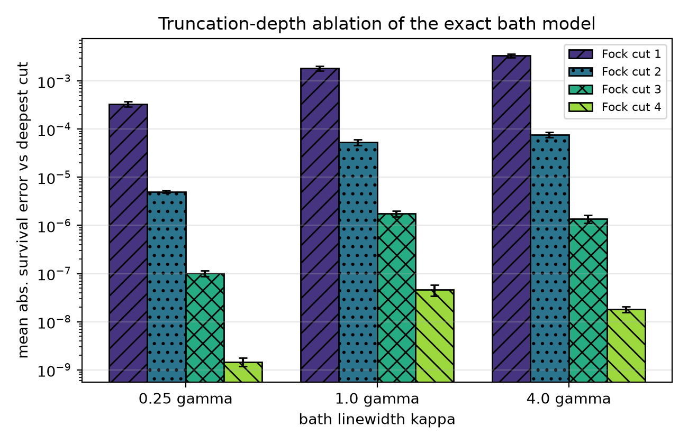
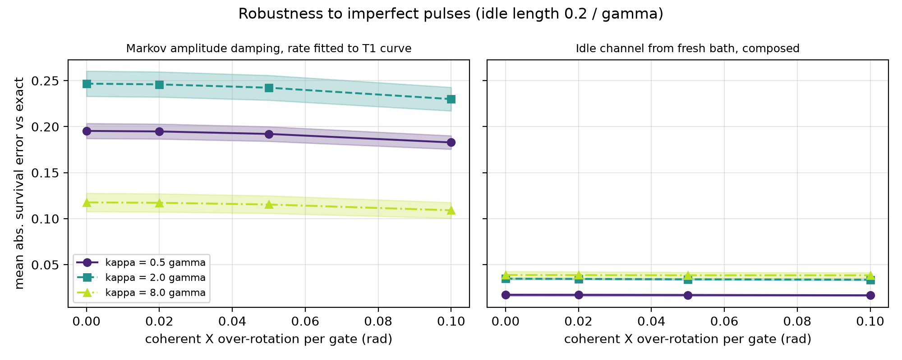
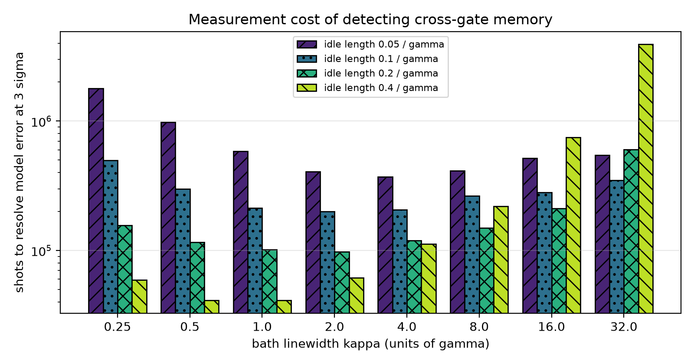

# When Does Composing an Idle Channel Fail? Non-Markovian Bath Memory and Gate-Sequence Error

[](LICENSE)
[](pyproject.toml)
[](https://github.com/pradeepdegalaroyal/non-markovian-idle-channel-composition-error/actions/workflows/ci.yml)

**Abstract.** Gate-error budgets are usually built by characterising one idle period as a completely positive trace-preserving (CPTP) channel and multiplying copies of it, which silently resets the environment at every gate. Using a numerically exact qubit-plus-damped-bath-mode simulation and random single-qubit Clifford sequences (5 seeds), this study measures how far that composition, and a Markov (memoryless) amplitude-damping model fitted to an energy-relaxation time (T1) curve, deviate from exact bath dynamics. The composition error is organised by the product of bath linewidth and idle length (kappa * tau) and not by the Breuer-Laine-Piilo (BLP) non-Markovianity witness; the study is a classical simulation of one qubit and one bath mode and makes no claim about any specific device or about quantum advantage.

## Summary of results

Random Clifford sequences of length m = 20, idle length tau = 0.2 / gamma after every gate, 60 sequences per seed, mean ± standard deviation over 5 seeds (source: `results/grid_per_seed.csv`, `results/summary_table.csv`). Rates are in units of gamma, the Markov-limit decay rate; kappa is the bath linewidth (memory time 1/kappa). "Error" is the mean absolute difference in ground-state survival from the exact bath simulation; "relative error" divides it by the survival that is lost.

| kappa | kappa * tau | exact survival | error, Markov fit to T1 curve | error, composed idle channel | relative error, Markov fit | relative error, composed idle | BLP measure |
|---|---|---|---|---|---|---|---|
| 0.25 | 0.05 | 0.984 | 0.124 ± 0.003 | 0.009 ± 0.001 | 7.84 ± 0.82 | 0.59 ± 0.09 | 0.246 |
| 0.5 | 0.1 | 0.969 | 0.188 ± 0.005 | 0.016 ± 0.002 | 6.09 ± 0.55 | 0.51 ± 0.07 | 0.103 |
| 1 | 0.2 | 0.941 | 0.236 ± 0.007 | 0.024 ± 0.003 | 4.02 ± 0.29 | 0.41 ± 0.05 | 0.027 |
| 2 | 0.4 | 0.893 | 0.237 ± 0.008 | 0.032 ± 0.003 | 2.22 ± 0.13 | 0.30 ± 0.03 | 0.002 |
| 4 | 0.8 | 0.822 | 0.187 ± 0.009 | 0.038 ± 0.003 | 1.05 ± 0.06 | 0.21 ± 0.02 | 0.000 |
| 8 | 1.6 | 0.739 | 0.113 ± 0.008 | 0.036 ± 0.003 | 0.43 ± 0.03 | 0.14 ± 0.01 | 0.000 |
| 16 | 3.2 | 0.673 | 0.054 ± 0.004 | 0.026 ± 0.002 | 0.17 ± 0.01 | 0.08 ± 0.01 | 0.000 |
| 32 | 6.4 | 0.639 | 0.023 ± 0.001 | 0.015 ± 0.002 | 0.06 ± 0.00 | 0.04 ± 0.01 | 0.000 |



*Figure 1. The composed idle channel's relative error falls onto one curve in kappa * tau for all four idle lengths and drops below 10 % only between kappa * tau = 1.6 and 3.2; the T1-fitted Markov model is far worse and depends on idle length as well.*

## What is new here

- It tests the "characterise one idle, then compose" noise model against exact bath dynamics for gate sequences, not for a single uninterrupted evolution, which is what the cited non-Markovianity and exact-dynamics literature addresses.
- It shows, with seeds, that the composition error collapses onto the idle-to-memory-time ratio kappa * tau (Spearman correlation 0.994 with -kappa * tau over the 32-cell grid), while the BLP witness is exactly zero for kappa >= 4 gamma where the relative error is still up to 0.42 (0.02-0.42 over the grid).
- It reports the measurement cost of detecting the effect: 4.1e4 to 3.9e6 shots to resolve the composition error at three standard errors, depending on the regime.

## Motivation

Fast hardware-calibration loops and error budgets assume that the environment forgets between gates. Breuer et al., 2016 (doi:10.1103/RevModPhys.88.021002) show that memory effects, including revivals of coherence, are common and can be classified and quantified; Tanimura, 2020 (doi:10.1063/5.0011599) reviews the hierarchical equations of motion (HEOM) that simulate strongly coupled, non-Markovian environments exactly; and Pita-Vidal et al., 2027 (doi:10.1016/j.physrep.2026.10.002) review hybrid semiconductor-superconductor qubits designed for robustness against local noise, where structured solid-state environments are the norm. None of these asks what happens when pulses repeatedly interrupt the system-bath evolution and a per-gate channel is composed afterwards.

## Research gap

The literature brief for this project contains four papers, so only those are cited: Breuer et al., 2016 (doi:10.1103/RevModPhys.88.021002), Tanimura, 2020 (doi:10.1063/5.0011599), Pita-Vidal et al., 2027 (doi:10.1016/j.physrep.2026.10.002) and Tran et al., 2019 (doi:10.1038/s41586-019-0975-z, structured solid-state environments in moiré heterostructures, adjacent context only). The related-work table is in [`docs/RESEARCH_GAP.md`](docs/RESEARCH_GAP.md). The gap: how wrong is the composed-channel model for gate sequences, and does a trace-distance witness predict it?

## Hypotheses and verdicts

Units as above; relative error as defined in the summary of results. The first analysis used the unnormalised error, which grows with total idle time and hides the memory dependence; the relative error was introduced after seeing this (both are in `results/`).

| Hypothesis | Verdict | Evidence (`results/summary_table.csv`, `results/summary_stats.json`) |
|---|---|---|
| H1. The T1-fitted Markov model errs by at least 10 % of lost survival whenever kappa * tau < 3. | Supported | Relative error 0.12-38.5 in every cell with kappa * tau <= 3.2; it first falls below 0.1 at kappa * tau = 6.4 |
| H2. The composed idle channel still errs by at least 10 % whenever kappa * tau < 1. | Supported | Relative error 0.13-0.67 for every cell up to kappa * tau = 1.6; it falls below 0.1 from kappa * tau = 3.2 |
| H3. The composition error is organised by kappa * tau, not by the BLP witness, which is zero for kappa >= 4 gamma. | Supported | Spearman correlation with -kappa * tau 0.994, with the BLP measure 0.811 (driven by the zero-versus-nonzero split); BLP is 0 in all cells with kappa >= 4, where relative error is 0.02-0.42 |

## Method



*Legend: T1 = energy-relaxation time; BLP = Breuer-Laine-Piilo non-Markovianity measure; Clifford = member of the 24-element single-qubit Clifford group; kappa = bath linewidth; tau = idle length.*

A qubit is resonantly coupled to one damped bath mode (a single-Lorentzian environment). The qubit-only population is validated against the closed-form damped Jaynes-Cummings solution (maximum deviation 1.1e-15, `results/summary_stats.json`). Each random Clifford sequence ends with its ideal inverse, so survival in |0> is 1 without noise, and an idle follows every gate. The reference simulates qubit and mode together (memory kept). The memoryless models reset the bath at every gate: the standard practice of composing a tomographed idle channel, and a Markov amplitude-damping model whose rate is fitted to a lifetime curve. A per-idle-matched Markov control is identical to the composed channel here (difference 4e-16) and is not reported separately. Full design in [`docs/METHOD.md`](docs/METHOD.md).

## Results



*Figure 2. Empirical cumulative distribution function (ECDF) of per-sequence error: the composed channel shifts the whole error distribution one to two decades below the T1-fitted Markov model, but it does not remove it (kappa = 1 and 16 gamma, tau = 0.2 / gamma, m = 20).*



*Figure 3. Ablation: the exact bath simulation converges quickly with Fock-cut depth; a cut of 1 errs by 3.3e-4 to 3.4e-3, a cut of 2 by at most 7.7e-5, and a cut of 4 by at most 4.6e-8 (`results/truncation_ablation.csv`), so the reference (cut 5) is converged.*



*Figure 4. Robustness: a coherent X over-rotation of up to 0.1 rad per gate leaves the model errors essentially unchanged (composed channel at kappa = 0.5 gamma: 0.0172 without and 0.0167 with 0.1 rad; Markov fit: 0.195 and 0.183).*



*Figure 5. Resolving the composition error at three standard errors on the averaged survival needs between 4.1e4 shots (kappa = 1 gamma, tau = 0.4 / gamma) and 3.9e6 shots (kappa = 32 gamma, tau = 0.4 / gamma); the cost is not monotonic because the signed mean difference partly cancels.*

Further numbers:

- Across the grid the largest absolute composition error is 0.054 and the largest absolute Markov-fit error is 0.237; the relative composition error ranges from 0.025 to 0.67 and the relative Markov-fit error from 0.040 to 38.5.
- The composed-channel error grows with sequence length (kappa = 1 gamma, tau = 0.2 / gamma: 0.0021 at m = 2 to 0.0297 at m = 30, `results/grid_per_seed.csv`).

## Discussion

The practical message is consistent across the three hypotheses. When the idle is long compared with the bath memory time (kappa * tau of about 3 and above) the standard composition is accurate to about 10 % of the lost survival or better; below that, cross-gate memory is a sizeable share of the error even in cells with small absolute error. A T1-fitted Markov model is a poor choice whenever the bath has memory: it errs by multiples of the survival it is trying to predict at short idles, because the early-time decay of a structured bath is quadratic, not exponential.

Two results are less comfortable. First, the BLP witness is of limited use as a go/no-go test: it is exactly zero for kappa >= 4 gamma although composition still errs by up to 42 % of lost survival there (a plausible, untested explanation is that the bath mode stays populated, slaved to the qubit with weight of order gamma / kappa, which a monotone trace-distance decay does not show). Its Spearman correlation of 0.811 with the relative error reflects only the zero-versus-nonzero split. Second, the absolute composition error is small (at most 0.054), and detecting it needs 4.1e4 or more shots, so on a device with realistic readout and gate error this effect competes with other error sources; this study does not show it dominates anything. The coherent-pulse sweep also shows no interaction between pulse error and memory in this model.

## Limitations

- One qubit and one bath mode with zero-temperature amplitude damping on resonance; no pure dephasing, thermal occupation, two-qubit gates, crosstalk or non-Lorentzian spectral densities (the latter would require a hierarchy or several modes).
- Gates are instantaneous and ideal in the main sweep; only coherent X over-rotation is tested.
- The composed idle channel and the per-idle matched Markov model coincide for this bath; for baths with a sign-changing coherence factor they would differ, which is untested.
- Relative error was added after seeing that absolute error confounds memory with total idle time (stated above); 4 idle lengths and 8 linewidths only; 60 sequences per seed.
- The shot estimate uses a binomial model for one averaged curve and ignores sequence-to-sequence variance and readout error.
- Everything is classical simulation; nothing here is a hardware measurement or a claim of quantum advantage.

## Future work

On hardware the same test is an idle-length scan: run random-sequence experiments with several inserted idle lengths, fit the composed-channel prediction from a tomographed single idle, and look for the residual that scales with kappa * tau. Extensions are multi-mode or HEOM baths for non-Lorentzian spectra, a process-tensor (memory-kernel) characterisation to replace the fresh-bath reset, and temperature and two-qubit gates, which matter for the hybrid semiconductor-superconductor devices reviewed by Pita-Vidal et al., 2027.

## Reproducibility

```bash
pip install -r requirements.txt
pip install -e .
pytest -q                           # 7 tests, about 4 s
python experiments/run_all.py       # full study, 70 s on the development laptop
python experiments/run_all.py --quick   # smoke run, about 20 s
```

The full run writes comma-separated values (CSV) and JavaScript Object Notation (JSON) files to `results/` and five figures at 200 dots per inch to `figures/`. Hardware: Windows 11, Python 3.11.9, central processing unit (CPU) only, numpy 2.2.6, scipy 1.17.1, pandas 2.3.3, matplotlib 3.11.1. The `--quick` flag writes to `quick_out/` unless `--out` is given. The continuous-integration workflow runs the tests and the quick run on Ubuntu.

## Project structure

```
src/bathmem/       model.py (exact bath, closed form, channels), circuits.py (Clifford sequences),
                   nonmarkov.py (BLP measure, shot cost), experiment.py (sweeps), plotting.py (figures)
experiments/       run_all.py (one command for everything)
tests/             test_bathmem.py
docs/              RESEARCH_GAP.md, METHOD.md
results/           grid_per_seed.csv, per_sequence_errors.csv, summary_table.csv, summary_stats.json,
                   truncation_ablation.csv, pulse_error_sweep.csv
figures/           fig1 ... fig5 (png)
```

## Related work by the author

- [shot-cost-of-non-markovian-memory-witnesses](https://github.com/pradeepdegalaroyal/shot-cost-of-non-markovian-memory-witnesses): shots needed to certify non-Markovian memory with the BLP revival criterion; this project asks the complementary question of whether such a witness predicts gate-sequence error.
- [probe-qubit-backflow-vs-chaos-ising-environment](https://github.com/pradeepdegalaroyal/probe-qubit-backflow-vs-chaos-ising-environment): information backflow of a dephasing probe qubit as a diagnostic of its environment.

## Citation

```bibtex
@software{degala_non_markovian_idle_channel_composition_error_2026,
  author  = {Degala, Chenchupradeep},
  title   = {When Does Composing an Idle Channel Fail? Non-Markovian Bath Memory and Gate-Sequence Error},
  year    = {2026},
  version = {0.1.0},
  url     = {https://github.com/pradeepdegalaroyal/non-markovian-idle-channel-composition-error},
  license = {MIT}
}
```

MIT license (`LICENSE`). Machine-readable citation metadata: `CITATION.cff`.
